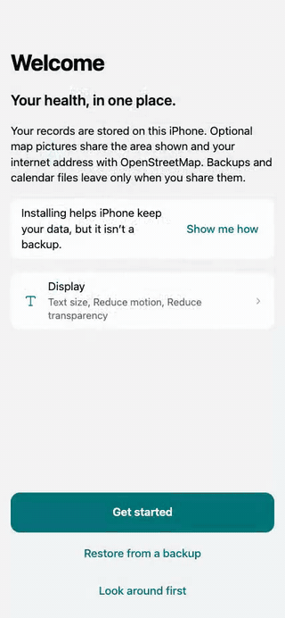
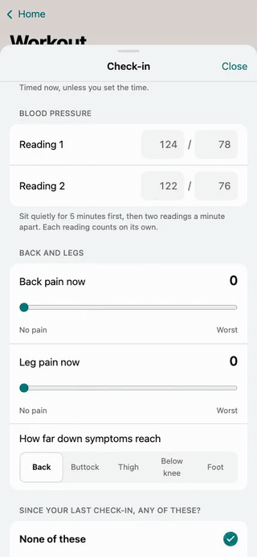
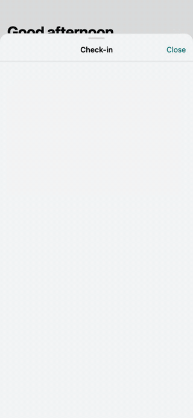
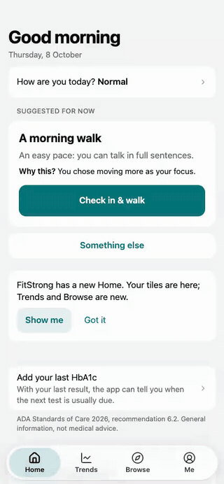

# FitStrong v2 on film

A walkthrough for reviewing PR #4: nine chapters, 3 min 22 s in all, recorded from the release candidate's own acceptance journeys. Each chapter opens with a 2-second card naming what to look for.

**The full film:** [fitstrong-v2-journey.mp4](fitstrong-v2-journey.mp4) (3:22, 7.5 MB), all nine chapters in order.

| Chapter 1: Set up once | Chapter 3: A guided workout | Chapter 4: After lunch | Chapter 6: A low |
|---|---|---|---|
|  |  |  |  |

The GIFs are silent previews: 10 s or less, 8 frames a second, 320 px wide. Chapter 1's runs at 2.4× to fit all of setup in; the others play at the films' speed.

## Chapters

| # | Film | Length | In the full film | Journey | What it shows |
|---|---|---|---|---|---|
| 1 | [Set up once](01-set-up-once.mp4) | 0:37 | 0:00 | V-J37 `main` | A fresh iPhone in Safari: page 1's install line and "Show me how"; setup a page at a time with P02's answers; Review offers a backup before moving to the Home Screen app; "Start using FitStrong" opens Home; Me → Data says "Not installed". Then, in the Home Screen app, the backup is restored on page 1, and setup carries on at Review ("Welcome back, let's carry on.") through to Home. |
| 2 | [The first morning](02-the-first-morning.mp4) | 0:26 | 0:37 | VJ01 | P01 at 9:00, stretching as the focus. Right now offers "Check in & stretch" with "Why this?"; the check-in, with two blood-pressure readings a minute apart, says "Go ahead, with changes"; the stretch runs to its summary and is saved; Home has 10 more minutes this week and "Stretched 1 day". |
| 3 | [A guided workout](03-a-guided-workout.mp4) | 0:24 | 1:03 | VJ06 | P01 on a training day, with the voice coach on. The Workout tile, then its hub's Right now ("Full Body B · 45 min"), Check in & start, the check-in and the player. **Start, and the coach says "Welcome." at once, first time, with no refresh** (the original voice bug). Then End → Finish now → Session complete → Save and finish, back to the Workout hub. |
| 4 | [After lunch](04-after-lunch.mp4) | 0:31 | 1:27 | V-J02 (`V02`), then V33 step 1 | P03 at 1:40 pm. Right now offers "I had lunch at 1:10 pm: walk now"; the check-in leads straight to the live walk; ten minutes pass and the coach says "Ten minutes of walking."; the summary says lunch was had at 1:10 pm; the walk is saved, and Home counts it. This walk measures neither distance nor steps, so it has nothing to ask. Part 2 is P02's first walk with GPS on, from V33: before it starts it asks to keep the route on this phone (Yes) and about map pictures (No). |
| 5 | [Log a usual lunch, and look up a food](05-a-usual-lunch-and-a-food.mp4) | 0:20 | 1:58 | V-J03 `usual-lunch`, then V-J08 | P01, meals only. The Food tile, then "Same as yesterday's lunch", then "Save meal": three taps, no figures; the Food tile and Today's log count it. Part 2: Browse searches "chapatti"; meal ideas wait until food allergies are answered (Me → Food, "No food allergies"); the search again finds "Roti, dal and sabzi", Back keeps the search, and the Guide card "Rice, roti and millets" opens. |
| 6 | [A low](06-a-low.mp4) | 0:12 | 2:18 | VJ04 | P03 on a sulfonylurea at 9:00. The Glucose hub, Add reading, 62: "This is a low. Treat it now." with its steps. Then Home's re-check surface ("Re-check at 9:15 am"), the Workout, Stretch and Walk tiles all "Waiting for your re-check at 9:15 am", and the Stretch hub's "Check again before you start", with no start. |
| 7 | [See my week](07-see-my-week.mp4) | 0:08 | 2:30 | VJ07 | P02, with a fortnight of steps. Trends: Your week in words (6,167 steps a day, from 3 days); the Steps row opens on Week against last week (+417 a day); the arrow keys read Tuesday against last Tuesday; Show as list; back to Trends. |
| 8 | [Customise Home](08-customise-home.mp4) | 0:14 | 2:37 | VJ12 `hide, add, move up, add, done` | P02. Edit Home: hide Sleep (with Undo), add Water, move Water up, add Labs, Done. Home keeps Water, Weight and Labs over a reload, and the Labs tile opens the Labs hub. |
| 9 | [Back up and restore, and Undo](09-back-up-restore-and-undo.mp4) | 0:31 | 2:51 | V-J11 `finished record`, then V-J32 | P01. Me → Data → Back up your record → Download. Part 2, a new phone: "Restore from a backup" on page 1 previews the file, then restores it, straight to Home. Part 3: water 250 ml twice (500 ml); both entries deleted, each with its own Undo; Undo brings the 500 ml back; leaving ends the other Undo; Recently deleted restores the 250 ml, and the day's total stays right. |

## How it was recorded

- **The acceptance journeys, as they run for the release** (`scripts/e2e/acceptance`), on branch `feat/v2-journey` at the release candidate, 6864ef9, with the recording knobs added in c22eba2. Only the harness changed; the app is the release candidate's. Each case shown passed in the recorded run, with every assertion it makes, and the assembly refuses a take whose case didn't pass.
- **Large light only**: 428 × 926 CSS pixels, light theme, in the suite's headless Chromium, filmed at that size. The clock is the suite's frozen Thursday 8 October 2026, 9:00 IST, unless a journey sets its own time. It moves only when a journey moves it, so a ten-minute walk, or a stretch run to its end, passes in seconds.
- **Synthetic personas only** (`fixtures/personas.mjs`): P01, P02 and P03, and P02's answers typed into setup. No real person's data is in any frame.
- **Slowed for viewing**: `FIT_SLOWMO=250` waits 250 ms after every tap, keypress and navigation. The screens otherwise move at the app's own speed. A recorded case also waits one second before it closes, so a film ends on a screen at rest.
- **Cuts**: the blank frames before the app first draws; the first step of V-J03 and VJ07, which only load the journey's fixture (yesterday's lunch, a fortnight of steps) through Me → Data → Restore; and V33 after its first step, its first walk's questions. Nothing else is cut or sped up.

## Sound

The films carry the coach's own recorded voice, the Heart pack (`public/voice/af_heart`). Each clip is mixed in at the moment the app played it: the harness logs every `play()` with its time from the video's first frame, which lines up with the screen to within two frames. While a line plays, a dark caption shows it ("Voice coach: …"). The caption belongs to the film, not the app.

- **Chapter 3**: "Welcome." as Start is tapped. It was recorded with `FIT_VOICE=on`, which turns P01's voice coach on. The personas keep the coach muted for the suite, so without it the session is silent.
- **Chapter 4**: "Ten minutes of walking." as the timer reaches 10:00. V-J02's persona has the coach on.
- **Every other chapter is silent**, because its journey plays no voice. In chapter 2 the coach is muted, as in the journey. With it on, the stretch's lines are cut off every quarter second, since the test clock jumps each step to its end, so that take wasn't used.
- **The GIFs are silent.**

## Re-recording

The harness records only when asked. With none of these set, the suite runs exactly as before.

- `FIT_VIDEO_DIR=<dir>` records every page of every case. It saves `<journey>__<project>__<case>.webm` (with `__2` for a case's second page), and beside it `<…>.clips.json`: the case's status, when each step began, and each voice clip played or stopped, all in ms from the video's first frame.
- `FIT_SLOWMO=<ms>` slows taps, keys and navigation.
- `FIT_VOICE=on` turns the personas' voice coach on.

Record the takes on large light, one case at a time for smooth video (through `/tmp/fit-checks/accept-locked.sh` if other runs share the machine), then build the films:

```sh
FIT_VIDEO_DIR=/tmp/fit-checks/demo/raw FIT_SLOWMO=250 npm run e2e:acceptance -- --projects=large-light --concurrency=1 \
  --only=V-J37,VJ01,V02,V-J03,V-J08,VJ04,VJ07,VJ12,V-J11,V-J32,V33 \
  '--case=^(main$|Right now → check-in|a walk after lunch|usual-lunch|chapatti finds the food|Glucose 62|Trends → Your week|hide, add, move up|finished record|water 250 ml twice|three breaks)'
FIT_VIDEO_DIR=/tmp/fit-checks/demo/raw FIT_SLOWMO=250 FIT_VOICE=on npm run e2e:acceptance -- --projects=large-light --concurrency=1 --only=VJ06
node docs/demo/assemble.mjs /tmp/fit-checks/demo/raw
```

`assemble.mjs` holds the story: which take goes in which chapter, the cards' words, and where each GIF starts. It needs ffmpeg with libx264 (`FFMPEG`, default `/opt/homebrew/bin/ffmpeg`). The cards and captions are drawn by the suite's headless Chromium, in the app's colours and the system font. Every film is H.264 at 25 frames a second with yuv420p and faststart, with AAC sound.
